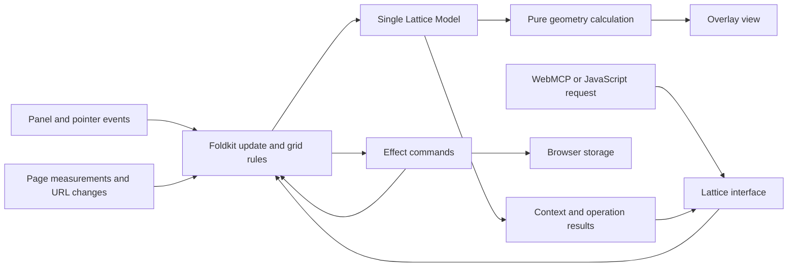

# Lattice architecture

Status: architecture discussion in progress; no runtime implementation.
Updated: 2026-10-28.

[PLAN.md](PLAN.md) defines product behavior. This document records the technology direction and proposed implementation design for handoff. Proposed choices below still need discussion or verification.

## Technology direction

- **Vite:** confirmed as the first installation target.
- **Effect v4 and Foldkit:** requested stack; the current upstream manifests support this combination.
- **TypeScript:** proposed implementation language, with a browser runtime independent of the consuming project's UI framework.

On 2026-10-28, Foldkit's main-branch package manifest identifies version `0.169.0` and exact peer dependencies on `effect@4.0.0` and `@effect/platform-browser@4.0.0`. Effect 4 has a stable release; Foldkit remains pre-1.0. Verify published packages at implementation time, pin a compatible set, and commit the lockfile. No dependencies have been installed or integration tested in this repository.

Sources: [Foldkit manifest](https://github.com/foldkit/foldkit/blob/main/packages/foldkit/package.json), [Effect release status](https://effect.website/blog/effect-v4-rc-september-recap), [Foldkit project status](https://github.com/foldkit/foldkit#readme).

## Proposed state ownership

Run Lattice as one embedded Foldkit program. One Model owns current grid configuration, preset library, viewing preferences, page measurements, and transient interaction state. The host website does not need to use Foldkit or Effect.

All edits enter the same update flow. Keep domain rules in pure functions called by update; do not introduce another mutable grid store that must be synchronized with Foldkit.

Foldkit's [architecture](https://foldkit.dev/core/architecture) provides Model, Message, update, Commands, and scoped subscriptions. Effect supplies schema validation, fallible browser operations, and resource cleanup. Geometry is ordinary deterministic calculation; it does not need an Effect runtime.

## Proposed modules

| Module | Responsibility |
| --- | --- |
| Domain | Item schemas, preset snapshots, validated operations, and visibility invariants. No DOM or storage access. |
| Geometry | Resolve settings against measured width and height. Return geometry with item ownership. Save source settings, not derived positions. |
| Program | Foldkit Model and update flow; coordinate domain changes, transient interactions, and commands. |
| Browser | Measurements, URL observation, pointer/keyboard events, and overlay rendering. Scope listeners and observers to the runtime. |
| Persistence | Versioned configuration encoding, base/query resolution, preset storage, and recovery from storage errors. |
| Agent adapters | WebMCP and ordinary JavaScript calls mapped into the same domain operations and context projection. |
| Vite adapter | Development-only injection and teardown support; no browser runtime imports from the consuming application's source. |

These are internal modules in one initial package, not independently published packages.

## Embedding and lifecycle

Use `Runtime.makeElement` and `Runtime.embed` for Lattice's isolated mount. Foldkit documents that this mode stays within its container without taking ownership of the page title or URL. Its embed handle provides typed ports and disposal. See [embedding](https://foldkit.dev/core/embedding).

Propose an HTMLElement mount inside a shadow root to isolate styles. Verify Foldkit rendering, focus, and pointer handling in this arrangement in the first integration slice. Renderer choice and detailed coordinate handling remain open.

Hiding the panel removes its visible UI while the program remains alive for shortcuts, state, and agent access. Uninstalling the overlay or replacing it during hot reload disposes the entire program, observers, listeners, pending work, and tool registrations. Do not start a second independent Effect runtime per adapter or action.

## Agent interface

Expose Lattice-specific read and edit operations over WebMCP, retaining the JavaScript fallback. The public interface uses serializable inputs and results; callers need not understand Foldkit Messages or Effect values.

Typed ports can bridge external requests into the embedded program. Project a documented context shape from the Model rather than exposing the internal Model as the public contract. Define request/result correlation and revision semantics before implementation: accepting a port message must not be reported as a completed or persisted edit.

Foldkit's [DevTools MCP](https://foldkit.dev/core/devtools) is useful for developing Lattice, but it is a separate integration from the requested WebMCP interface. Propose disabling Foldkit's debugging overlay and recording by default in consumer projects, so Lattice does not introduce another launcher or an unbounded pointer-event history.

## Development-only delivery

Use a Lattice Vite plugin restricted to development serving, with a development-only client entry. Vite supports conditional plugin application through [`apply`](https://vite.dev/guide/api-plugin.html#conditional-application). Confirm preview and host-access behavior before release; a development command alone does not establish that a page is local.

Keep Lattice's bundled Foldkit/Effect runtime independent of the host application's versions. Verify packaging and bundling before promising compatibility with hosts that already use either dependency.

The first integration check must demonstrate both a functioning overlay during development and production output with no Lattice JavaScript, CSS, or runtime references. Foldkit's own DevTools production exclusion does not establish exclusion of Lattice as a whole.

## Next decisions

1. Undo/redo scope and transaction rules: propose one completed drag or agent batch per undo step; transient pointer motion stays out of persisted configuration.
2. Coordinate conventions, renderer, and long-document behavior.
3. Domain schemas, agent operation results, and preset transactions.
4. Persistence versioning, URL identity, navigation, and failure behavior.
5. Package entry points, development-host rules, shortcuts, and focused acceptance tests.

The handoff is not implementation-ready until the relevant open decisions here and in PLAN.md are resolved or explicitly delegated as implementation choices.
