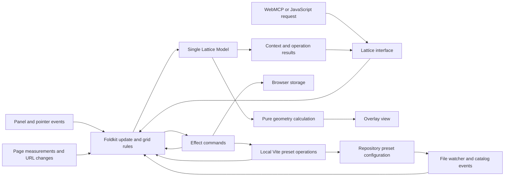

# Lattice architecture

Status: architecture discussion in progress; no runtime implementation.
Updated: 2026-10-28.

[PLAN.md](PLAN.md) defines product behavior. This document records the technology direction and proposed implementation design for handoff. Proposed choices below still need discussion or verification.

## Technology direction

- **Vite:** confirmed as the first installation target.
- **Effect v4 and Foldkit:** requested stack; the current upstream manifests support this combination.
- **TypeScript:** proposed implementation language, with a browser runtime independent of the consuming project's UI framework.

On 2026-10-28, Foldkit's main-branch package manifest identifies version `0.169.0` and exact peer dependencies on `effect@4.0.0` and `@effect/platform-browser@4.0.0`. Effect 4 has a stable release; Foldkit remains pre-1.0. Verify published packages at implementation time, pin a compatible set, and commit the lockfile. No dependencies have been installed or integration tested in this repository.

Sources: [Foldkit manifest](https://github.com/foldkit/foldkit/blob/main/packages/foldkit/package.json), [Effect release status](https://effect.website/blog/effect-v4-rc-september-recap), [Foldkit project status](https://github.com/foldkit/foldkit#readme).

## Proposed state ownership

Run Lattice as one embedded Foldkit program. One Model owns current grid configuration, a loaded projection of the preset catalog, viewing preferences, page measurements, transient interaction state, and undo/redo history. The repository file is authoritative for project preset definitions. The host website does not need to use Foldkit or Effect.

All edits enter the same update flow. Keep domain rules in pure functions called by update; do not introduce another mutable grid store that must be synchronized with Foldkit.

Foldkit's [architecture](https://foldkit.dev/core/architecture) provides Model, Message, update, Commands, and scoped subscriptions. Effect supplies schema validation, fallible browser operations, and resource cleanup. Geometry is ordinary deterministic calculation; it does not need an Effect runtime.

## Proposed modules

| Module | Responsibility |
| --- | --- |
| Domain | Item schemas, preset snapshots, validated operations, and visibility invariants. No DOM or storage access. |
| Geometry | Resolve settings against measured width and height. Return geometry with item ownership. Save source settings, not derived positions. |
| Program | Foldkit Model and update flow; coordinate domain changes, transient interactions, and commands. |
| Browser | Measurements, URL observation, pointer/keyboard events, and overlay rendering. Scope listeners and observers to the runtime. |
| Browser persistence | Versioned applied-page configuration, base/query resolution, viewing preferences, and recovery from storage errors. |
| Preset repository | Server-side project preset loading, validation, file writes, conflict handling, and change notifications. |
| Agent adapters | WebMCP and ordinary JavaScript calls mapped into the same domain operations and context projection. |
| Vite adapter | Development-only injection, preset-operation middleware, file watching, catalog notifications, and teardown. No browser runtime imports from the consuming application's source. |

These are internal modules in one initial package, not independently published packages.

## Preset catalog and persistence scopes

Confirmed: reusable project presets live in a configuration file in the consuming repository, are loaded for everyone using that configuration, and are written by panel saves through the local development server. The first save creates the file when absent. This replaces the earlier origin-wide browser preset library. Applied grid configurations and viewing preferences remain browser-local.

The six built-ins and read-only built-in behavior are confirmed; plugin configuration can exclude them. See [PLAN.md](PLAN.md) for their contents. Team members receive repository preset changes through normal Git workflows; connected pages on one development server can receive live catalog notifications.

Proposed storage design:

- Use `builtInPresets: boolean` (default `true`) and `presetsFile: string` (default `./lattice.presets.json`, resolved against the Vite project root). These names and the JSON format are proposed. Additional inline definitions in `vite.config.ts` are under discussion; do not assume the panel rewrites executable TypeScript configuration.
- Load the dedicated file on the server, validate it with the shared preset schema, and send a serializable catalog to the browser. A missing file means an empty project catalog until the first successful save. An invalid or unreadable existing file is an error and must not be replaced with an empty file.
- Keep schema version, stable preset IDs, names, and flat item definitions in the project file. Derive catalog/preset revisions from validated contents for conflict checks and explicit updates. Use deterministic formatting to keep Git diffs readable.
- Keep built-in definitions separate from project file data. When disabled, omit them from the available catalog and served catalog definitions. Use stable namespaced IDs and source metadata for both kinds. Source does not introduce another grid-item type.
- Applying either kind creates the same preset item: copied underlying items plus source identity/revision. Persist that snapshot in browser page state. File changes, disabled built-ins, or package upgrades do not silently modify applied grids; the existing explicit Update from preset action handles updates. A missing source leaves its snapshot usable.
- Namespace browser page storage by project identity as well as origin and URL to prevent collisions when unrelated local projects reuse an address. Preset definitions themselves follow the configured project file, including when the development server's port changes. Project-identity derivation remains to be specified.
- Baseline presets use ordinary row items with automatic count and no gutter, rather than storing thousands of individual lines or introducing another item type. Derive their geometry from current document height.
- Agents list and mutate the catalog through Lattice's supported interface. File-backed saves use the same local-server operations as panel saves and report their actual persistence outcome.

### File loading and saving

Use Vite's [development-server middleware](https://vite.dev/guide/api-plugin.html#configureserver) for narrowly scoped preset reads and mutations. Use its [custom client/server events](https://vite.dev/guide/api-plugin.html#client-server-communication) to notify connected pages that the catalog revision changed. These are proposed Lattice operations built on documented Vite hooks, not features already implemented here.

Proposed save flow:

1. Capture the selected page items and current page/catalog revisions; flatten included presets into copied underlying items and assign a stable preset ID.
2. Send a validated create/update operation to the local development server with an expected catalog revision and retry identity.
3. The server reloads and validates the current file, detects stale requests, and serializes writes to that file. Create the file only when it is absent. Write through a temporary file and replace atomically to avoid partial JSON. Coordinate multiple server processes using the same file; an atomic rename alone does not prevent concurrent edits from being overwritten.
4. Return the saved preset and resulting revision only after the write completes. Retries use the same identity so a lost response cannot silently create duplicate presets. Preserve existing data and return a conflict/error if safe application cannot be established.
5. Apply the saved preset to the initiating page through the ordinary update flow and persist its page configuration. If navigation or other edits invalidate the captured selection, report that the definition was saved but the page application was not performed; do not apply it to a different page.
6. Notify connected clients and reload the catalog. Watch manual edits, creation, and deletion, including when the file was missing at startup. Keep applied snapshots intact. Invalid manual edits show an error and may retain a clearly marked last-valid catalog; writes remain blocked until the source is valid.

A repository write and browser-state update are separate commits. Report saved/applied/persisted outcomes accurately and define retry/recovery behavior; do not promise an atomic transaction spanning the filesystem and browser storage. Ordinary multi-item page edits can still be atomic and occupy one undo step. Undo of the repository definition itself remains an explicit product decision.

### Local write scope

The server, not a browser-supplied path, chooses the configured preset file. Restrict writes to that approved project file, reject path traversal and out-of-scope symlink targets, validate operation schemas and payload sizes, and gate mutations on the allowed development origin and a per-server write token. Fail closed for unsupported remote exposure. Register no mutation endpoints in build or production preview.

Implement these checks in the preset repository/middleware. Vite's [`server.fs` settings](https://vite.dev/config/server-options.html#server-fs-strict) describe file serving and do not themselves authorize or constrain custom mutation handlers. Keep Node filesystem dependencies out of browser entry points. The exact hostname/LAN policy still needs resolution before release.

Open decisions: final file format/path, optional inline definitions, color defaults, editing/deleting definitions, name collisions, and undo scope for repository mutations. Implement and test stale-write detection, concurrent-server coordination, and failure recovery before enabling saves.

## Embedding and lifecycle

Use `Runtime.makeElement` and `Runtime.embed` for Lattice's isolated mount. Foldkit documents that this mode stays within its container without taking ownership of the page title or URL. Its embed handle provides typed ports and disposal. See [embedding](https://foldkit.dev/core/embedding).

Propose an HTMLElement mount inside a shadow root to isolate styles. Verify Foldkit rendering, focus, and pointer handling in this arrangement in the first integration slice. Renderer choice and detailed coordinate handling remain open.

Hiding the panel removes its visible UI while the program remains alive for shortcuts, state, and agent access. Uninstalling the overlay or replacing it during hot reload disposes the entire program, observers, listeners, pending work, and tool registrations. Do not start a second independent Effect runtime per adapter or action.

## Coordinate units and zoom

Confirmed: all pixel-based coordinates and grid dimensions use CSS pixels. Every line is 1 CSS pixel thick. Browser zoom scales their apparent thickness with the page; there is no constant-device-pixel hairline mode in v1.

Keep source values in their original units. Browser zoom must not rewrite a stored pixel position, gutter, or margin. Recompute stretch geometry and percentage positions against current CSS-pixel dimensions when those dimensions change.

Confirmed drag precision: individual guides stored in pixels snap to the nearest whole CSS pixel when dragged, including Option/Alt duplication. Apply snapping to the resulting guide position after coordinate conversion and drag-offset calculation. Do not round source configurations merely because they were loaded, or apply this drag rule to generated grids and percentage guides.

Proposed renderer rule: perform measurements and geometry calculations in the same CSS coordinate system without multiplying logical positions by device pixel ratio. If a raster renderer needs a higher-resolution backing surface, keep that conversion internal to rendering. Preserve fractional generated geometry and percentage positions. Origins, scrollbar treatment, numeric-entry precision, renderer choice, and pinch-zoom behavior remain open.

## Agent interface

Expose Lattice-specific read and edit operations over WebMCP, retaining the JavaScript fallback. The public interface uses serializable inputs and results; callers need not understand Foldkit Messages or Effect values.

Typed ports can bridge external requests into the embedded program. Project a documented context shape from the Model rather than exposing the internal Model as the public contract. Define request/result correlation and revision semantics before implementation: accepting a port message must not be reported as a completed or persisted edit.

Foldkit's [DevTools MCP](https://foldkit.dev/core/devtools) is useful for developing Lattice, but it is a separate integration from the requested WebMCP interface. Propose disabling Foldkit's debugging overlay and recording by default in consumer projects, so Lattice does not introduce another launcher or an unbounded pointer-event history.

## Undo and redo

Confirmed for v1: undo/redo with standard keyboard shortcuts, one completed drag per history step, and one grouped agent edit per step. The platform bindings are recorded in [PLAN.md](PLAN.md).

History is session-only: keep undo/redo data in memory, exclude it from persisted schemas, and initialize both histories empty on a fresh page load. Saved grid configurations survive refresh or reopening the page; their history does not.

Confirmed navigation behavior: loading another page's grid configuration clears undo and redo, including client-side navigation without a refresh. Returning to a previously visited page reloads its saved configuration with empty histories; do not retain a per-page history cache.

Proposed implementation:

- Keep history in the Foldkit Model and apply undo/redo through the same update flow as other edits. Foldkit DevTools history is not the product's undo mechanism.
- Record committed domain changes, preserving stable IDs. Keep pointer previews separate from committed configuration; commit once when the drag finishes. A canceled drag restores its starting state without creating a history entry.
- Treat a grouped agent edit as one validated, atomic transaction. Invalid groups and no-op edits do not add history. A new committed edit after undo clears the redo branch.
- Undo/redo changes source settings and recalculates geometry using current page dimensions. Persist the resulting configuration through the normal persistence path.
- Gate keyboard handling on focus within Lattice, including a focused individual guide. Leave text-editing controls and host-page shortcuts alone. Account for shadow-root event paths when identifying the actual focused control.
- Reset history when navigation switches the resolved configuration scope, rather than on every URL notification. Creating a query-specific configuration through an edit is still an undoable edit, not a navigation reset.
- Cancel an in-progress drag when navigating to another configuration. Associate pending reads, writes, and agent results with their originating scope so late work cannot mutate the newly active page. Persistence commands capture their target scope when created.
- History limits and shared preset-library changes remain open.

## Development-only delivery

Use a Lattice Vite plugin restricted to development serving, with a development-only client entry. Vite supports conditional plugin application through [`apply`](https://vite.dev/guide/api-plugin.html#conditional-application). Confirm preview and host-access behavior before release; a development command alone does not establish that a page is local.

Keep Lattice's bundled Foldkit/Effect runtime independent of the host application's versions. Verify packaging and bundling before promising compatibility with hosts that already use either dependency.

The first integration check must demonstrate both a functioning overlay during development and production output with no Lattice JavaScript, CSS, or runtime references. Foldkit's own DevTools production exclusion does not establish exclusion of Lattice as a whole.

## Next decisions

1. Coordinate origins, scrollbar treatment, numeric-entry precision, renderer, and long-document behavior. CSS-pixel coordinates, 1 CSS pixel strokes, and whole-pixel individual dragging are confirmed.
2. Undo/redo keyboard ownership, history limits, and shared preset-library scope. Session-only history, reset on navigation to another configuration, and drag/batch grouping are confirmed.
3. Domain schemas, agent operation results, and preset transactions.
4. Persistence versioning, URL identity, navigation, and failure behavior.
5. Preset configuration interface, file-write conflict/recovery semantics, and project identity for browser storage.
6. Package entry points, development-host rules, shortcuts, and focused acceptance tests.

The handoff is not implementation-ready until the relevant open decisions here and in PLAN.md are resolved or explicitly delegated as implementation choices.
