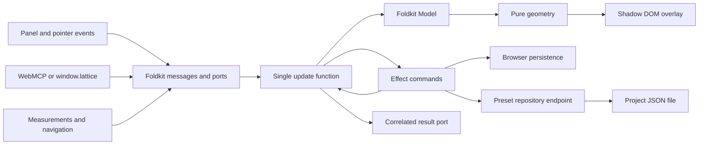

# Lattice implementation architecture

Status: initial implementation complete; release validation remains. Updated 2026-10-28.

Read [PLAN.md](PLAN.md) for product decisions and [README.md](README.md) for installation. This document describes the code another agent will take over.

## Runtime and package boundary

One package contains a Node-side Vite plugin and a separately bundled browser client. Effect `4.0.0`, platform-browser `4.0.0`, and Foldkit `0.169.0` are pinned to Foldkit's exact peer dependencies. Vite 8 is the development/test toolchain; the declared plugin peer range is Vite 7–8, with Vite 7 not yet separately verified.

`scripts/build.mjs` bundles the browser entry and its Effect/Foldkit dependencies into `dist/client.js`. Node entry points keep dependencies external. TypeScript emits declarations. The client is about 660 KB minified before compression and is development tooling only. The host application's Effect/Foldkit versions do not supply this runtime.

The plugin uses `apply: 'serve'` and injects a module through `transformIndexHtml` only while an actual development server exists. Application source imports no runtime. Preview has no injection or custom routes. A production test compares every output file against the same build without the plugin.

## State and operation flow

`browser/program.ts` owns the sole application model through Foldkit. It contains page state, catalog projection, preferences, measurements, history, selections, input drafts, pending requests, and drag previews. `Runtime.makeElement` and `Runtime.embed` mount inside a shadow root. The mount has a unique ID, which Foldkit requires even in embedded mode. Foldkit DevTools are disabled.

Panel actions and API requests use the same validated operations. Mutating requests are serialized while persistence or a preset write is pending. Each request carries an ID and originating URL scope; optional `expectedRevision` rejects stale edits. Batch validation completes before a new configuration is committed. The result port acknowledges completion after storage, not merely port acceptance. Rendering follows on Foldkit's next animation frame.

Measurements and navigation can arrive during IO. A preset save captures page identity and revision. Its response applies the saved snapshot only if that origin remains current and unchanged; otherwise it reports `saved: true, applied: false`. Browser writes capture their target keys. Navigation clears histories and cancels previews. Queued requests for an old page are rejected.

## Module map

| File                               | Responsibility                                                                |
| ---------------------------------- | ----------------------------------------------------------------------------- |
| `src/domain.ts`                    | Effect schemas, identity, defaults, snapshot copying, validated transactions. |
| `src/geometry.ts`                  | CSS-pixel formulas, deduplication, viewport culling, density limits.          |
| `src/state.ts`                     | Edits, session history, preset capture/application, context projection.       |
| `src/storage.ts`                   | Versioned localStorage, URL scopes, query copy-on-write.                      |
| `src/presets.ts`                   | File validation, source namespacing, built-ins and snapshot revisions.        |
| `src/server/preset-repository.ts`  | Loading, validation, locking, revisions, atomic file replacement.             |
| `src/vite.ts`                      | Dev injection, local-only middleware, watching and catalog events.            |
| `src/browser/program.ts`           | Model/update/commands, sequencing and acknowledgments.                        |
| `src/browser/view.ts`, `styles.ts` | Floating panel and overlay, field controls and preset selection.              |
| `src/browser/api.ts`, `actions.ts` | Public types, WebMCP adapter/schema, strict action validation.                |
| `src/client.ts`                    | Lifecycle, browser listeners, measurement, fetch/storage services, JS bridge. |
| `src/setup.ts`                     | Skill/reference installation and additive AGENTS.md pointer.                  |

Internal Foldkit messages/model use typed declaration schemas. Untrusted operations and file contents use strict structural Effect schemas. Public callers receive serializable context, never the Model or Effect values. UUIDs are generated for creation/copy operations and request identities; geometry has no side effects.

## Geometry and interaction

Fixed-position DOM lines draw only the current viewport. X starts at the viewport's left edge using `documentElement.clientWidth`; Y starts at the document top, subtracting `scrollY` for rendering. The fixed overlay adds no layout height. Generated boundaries and percentages retain fractions. Pixel drags round the final coordinate after subtracting the grab offset.

Stretch size is `(length - 2 * margin - (count - 1) * gutter) / count`. Fixed items use size, count, alignment, and applicable offset. Auto count fills the available dimension with complete sections; center ignores offset. Auto plus stretch is rejected. Negative stretch size warns and draws nothing. Shared boundaries within an item are deduplicated to numeric tolerance.

Culling bounds work on long pages. A maximum of 5,000 visible lines and 10,000 loop iterations per item prevents excessive density from hanging the page. Context includes analytical formulas and a `truncated` flag; source settings remain intact. Derived line arrays are never persisted.

Standalone individual guides have 9px transparent hit areas around 1px strokes. Previews are transient; drag completion creates one history entry, cancellation none. Alt/Option creates an independent duplicate. Generated and preset lines have no pointer handlers. Command/Control disables guide hit areas. Keyboard ownership uses composed event paths through the shadow root.

The hidden panel has no launcher. Master grid visibility gates panel visibility while preserving its preference. Panel position is session-only. Numeric drafts live in the Model so measurement renders do not erase partially typed fields.

## Storage and history

Keys contain schema version, project ID, origin, path, and optional canonical query. The default project ID hashes the real Vite root; config can provide a stable ID. Query parameters are stably sorted by key; duplicate-value order is retained. Hashes are ignored.

Query URLs inherit an existing base configuration. The first configuration edit creates an independent override. A query URL with no base creates the base first. Individual visibility is an edit; master visibility is separate. Undo can remove a newly created query override. Reset-to-base removes the override and clears history. Page loads clear both histories; at most 100 snapshots remain in memory.

Storage errors leave edits in memory and return `persisted: false`. Invalid stored data is not silently overwritten: the panel offers an explicit reset. There is no cross-tab reconciliation; separate tabs can overwrite the same page key. This is a follow-up distinct from repository presets.

Undo of **Save preset** restores previous page items and retains the repo definition. Redo restores the snapshot without another write. Shared definition deletion is explicit and outside page undo.

## Preset repository

Built-ins, inline options, and the dedicated JSON file share one catalog. IDs are namespaced; inline/built-in entries are read-only. Files use `{ version: 1, presets: [{ id, name, items }] }` with flat leaf items. Missing files mean an empty file catalog; invalid files block writes.

Applied presets copy source settings, identity, and revision into browser storage. Source changes/removal leave those copies intact. Unlink releases underlying items with effective visibility; explicit update replaces a snapshot from its current source.

The server owns the file path, restricted inside Vite's root with no symlinks along the relative path. Requests are limited to 1 MiB and protected by loopback host checks, origin checks, and a per-server token. No browser-supplied path is accepted. Exclusive lock creation prevents simultaneous writers across servers; competing operations get a conflict. Stale revisions use SHA-256 of raw file contents. A temporary file is flushed and renamed after checking the file again.

An identical save under the same stable preset ID is idempotent, including after a lost response. A newly dispatched create action gets a new ID: inspect uncertain results before repeating it. Atomic rename prevents partial files, but external editors do not honor the lock; it is not a compare-and-swap against uncooperative writers. Crashed servers can leave a lock requiring explicit recovery.

Repository and browser saves are separate commits. Results expose `saved`, `applied`, and `persisted` separately. File watching notifies clients through Vite custom events. Invalid manual edits retain the last valid catalog with an error; source snapshots remain usable.

## Agent and lifecycle boundaries

`window.lattice` provides `read`, `execute`, `batch`, and `dispose`. Context includes settings, dimensions, scope, visibility, history counts, catalog, and resolved viewport geometry. Context resolution includes hidden items and preset children for layout alignment; geometry's `visible` flag reflects combined item/preset visibility before the master toggle. Rendering still excludes hidden items. Reading changes neither settings nor visibility. Strict action/domain validation applies to both UI and agents. Requests time out after 15 seconds with an uncertain-outcome error; timeout does not roll back writes.

WebMCP registers `lattice_read` and `lattice_edit` via feature-detected `document.modelContext.registerTool`. Abort signals remove registrations. The JS fallback remains active while hidden. Adapter tests use a harness; native external agent discovery remains to verify.

Disposal removes the host/runtime, observers, listeners, timers, HMR subscription, and tools. History wrappers are restored only if still owned by Lattice. Pending requests are rejected; fetches are aborted, though an accepted server write may finish.

## Tests and next work

`npm run check` covers types, geometry, history/query semantics, file conflicts/invalid data/symlinks, setup, production exclusion, and building. `npm run test:browser` covers panel/API operations, dragging, keyboard ownership, resize/navigation, storage errors, preset save/update/undo, and the WebMCP adapter.

Before publishing: finalize package name/license, verify supported browsers and real browser zoom, validate native WebMCP agent discovery, and check Vite 7 separately. Product backlog includes element grids, breakpoints, snapping, touch refinement, overlap selection, configurable shortcuts/URL matching, and cross-tab reconciliation. Extend the existing state owner rather than adding a second store.
